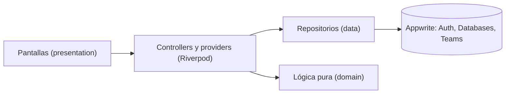
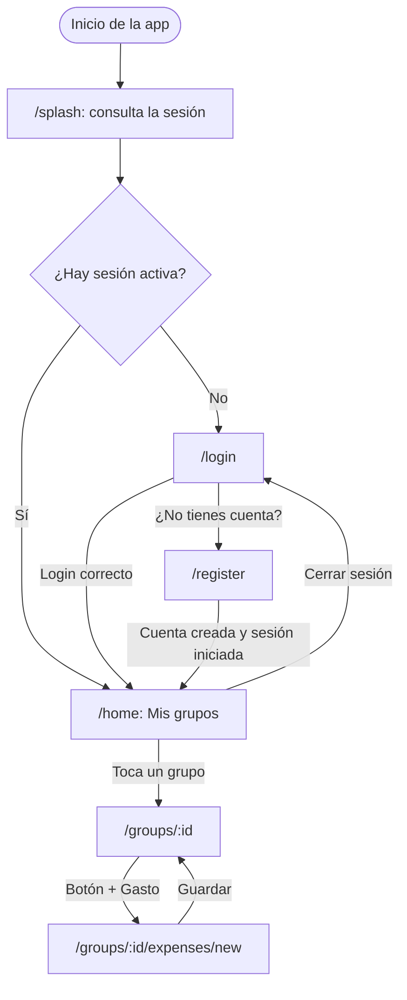
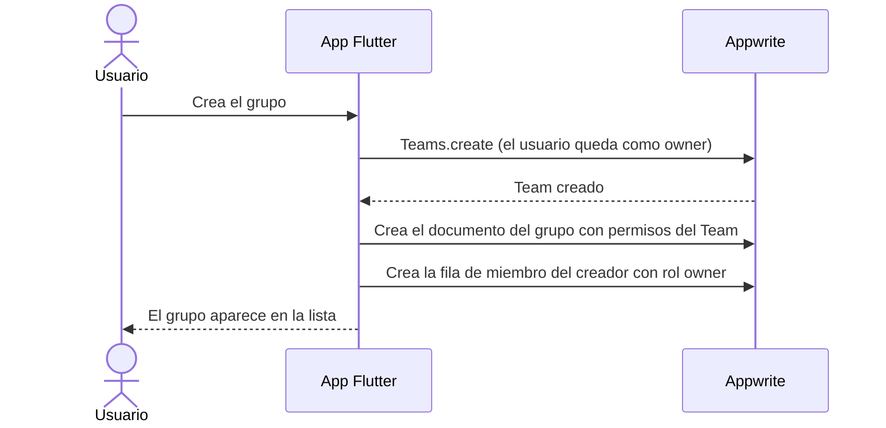
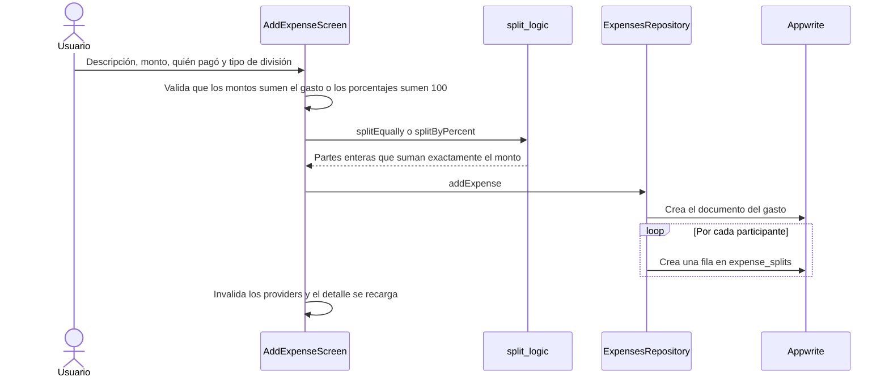
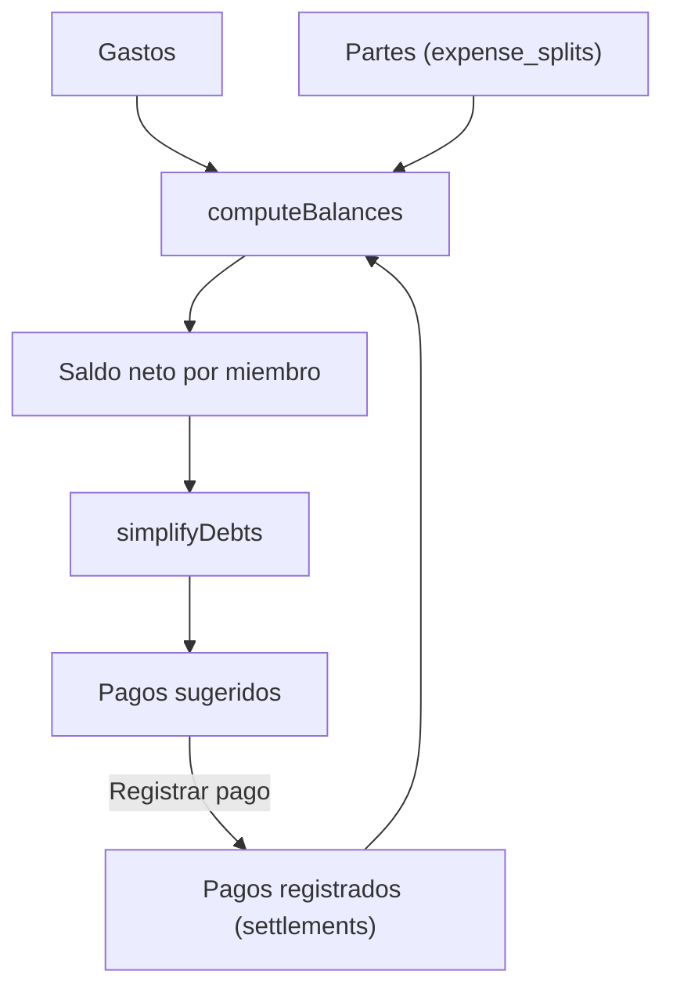
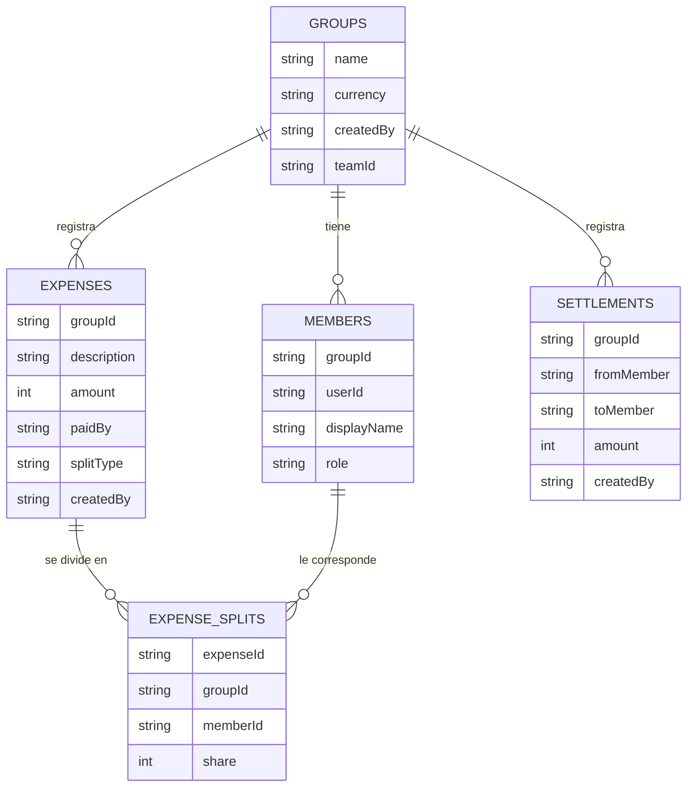

# Monitor Deuda App — Gastos compartidos

App móvil para dividir gastos entre varios y saber, sin hacer cuentas a mano, **quién le debe a quién**. Pensada para viajes, salidas y casas compartidas. Hecha con **Flutter** y **Appwrite**.

> Nombre del paquete en el código: `monitor_deuda`.

## Qué hace

- **Cuentas:** registro, inicio y cierre de sesión. La sesión persiste al cerrar la app.
- **Grupos:** cada grupo es un *Team* de Appwrite, así que solo sus miembros pueden ver sus datos.
- **Miembros:** con cuenta o sin cuenta (por ejemplo, un amigo que no usa la app).
- **Gastos con tres tipos de división:**
  - partes iguales,
  - montos exactos (por ejemplo, "yo no tomé alcohol, no me cobres eso"),
  - porcentajes.
- **Saldos por persona**, calculados a partir del historial.
- **Pagos sugeridos:** simplificación de deudas para saldar todo con pocas transferencias.
- **Pagos registrados:** una deuda baja a $0 sin borrar el historial de gastos.
- **Borrar gastos** manteniendo presionado.

## Tecnologías

| Área | Herramienta |
|---|---|
| Interfaz | Flutter (Material 3) |
| Estado e inyección de dependencias | Riverpod (`AsyncNotifier`, `FutureProvider.family`) |
| Navegación | go_router, con redirección según la sesión |
| Backend | Appwrite: Auth, Databases (Tables) y Teams |
| Tests | `flutter_test` sobre la lógica de reparto y de deudas |

## Arquitectura

Organización **por funcionalidades** (`features`). Cada una se divide en tres capas:

- **domain:** modelos y lógica pura. No depende de Flutter ni de Appwrite, por eso se prueba con tests simples.
- **data:** repositorios. Son los únicos que hablan con Appwrite.
- **presentation:** pantallas y controllers.



```
lib/
├── main.dart
├── core/
│   ├── appwrite/        # cliente, providers y IDs de tablas
│   ├── router/          # go_router y reglas de acceso
│   └── utils/           # formato de dinero
└── features/
    ├── auth/            # login, registro y sesión
    ├── groups/          # grupos y miembros
    ├── expenses/        # gastos, saldos, pagos y deudas
    └── home/            # lista de grupos
```

## Flujo de la app

### Navegación y sesión

El router escucha el estado de sesión y decide a dónde ir. Las pantallas de login **no navegan solas**: cuando el login tiene éxito, el estado cambia y el router redirige.



### Crear un grupo

La seguridad no depende de la interfaz: el permiso de lectura de cada documento apunta al Team del grupo, y Appwrite solo devuelve lo que el usuario puede leer.



### Registrar un gasto



### Cómo se calculan los saldos

Los saldos **no se guardan**: se derivan del historial, así nunca se desincronizan.



Reglas del cálculo:

- A quien pagó un gasto se le suma el monto completo.
- A cada participante se le resta la parte que le corresponde.
- Un pago entre personas sube el saldo de quien paga y baja el de quien recibe.
- La suma de todos los saldos es siempre 0.

## Decisiones técnicas

**Dinero como enteros.** Los pesos chilenos no tienen decimales, así que todos los montos son `int`. Con `double` se acumulan errores binarios y un saldo que no cuadra destruye la confianza en una app de dinero.

**Reparto sin perder pesos.**
- Partes iguales: `$100` entre 3 da `34 + 33 + 33`, y la suma siempre es exactamente el monto.
- Porcentajes: método del mayor resto. Cada uno recibe la parte entera de su porcentaje y los pesos sobrantes van a quienes tienen la mayor fracción.

**Simplificación de deudas.** Algoritmo voraz: se empareja al mayor deudor con el mayor acreedor y se salda el menor de los dos montos, hasta dejar todo en cero. Termina en como máximo *n − 1* transferencias. Encontrar el mínimo absoluto es un problema NP-difícil y no se justifica para esta app.

## Modelo de datos (Appwrite)



Notas:

- `members.userId` es opcional: un miembro sin `userId` es alguien que no usa la app.
- `paidBy`, `memberId`, `fromMember` y `toMember` guardan el ID de una fila de `members`, no de un usuario.
- Los textos son columnas `Varchar` (36 para IDs, 100 o 200 para nombres y descripciones, 20 para `role` y `splitType`, 3 para `currency`).

## Cómo correr el proyecto

### Requisitos

- Flutter SDK y Android Studio con un emulador o un celular con depuración USB.
- Un proyecto de Appwrite (Cloud o instancia propia).

### 1. Preparar Appwrite

1. Crea un proyecto y registra la plataforma **Flutter → Android** con el `applicationId` de `android/app/build.gradle(.kts)`.
2. Crea una base de datos.
3. Crea las cinco tablas del modelo de datos (`groups`, `members`, `expenses`, `expense_splits`, `settlements`) con las columnas indicadas, todas requeridas salvo `members.userId`. Los montos son `Integer`.
4. En `members`, `expenses`, `expense_splits` y `settlements`, crea un índice `idx_groupId` de tipo **Key** sobre la columna `groupId`.
5. En **Security** de cada tabla:
   - agrega el rol **All users** con el permiso **Create**,
   - activa **Row security**.

   Los permisos de lectura, edición y borrado de cada fila los asigna la app según el Team del grupo.

### 2. Configurar la app

Copia los IDs reales (proyecto, base de datos y tablas) en `lib/core/appwrite/appwrite_constants.dart`:

```dart
class AppwriteConstants {
  static const endpoint = 'https://cloud.appwrite.io/v1'; // el de tu consola
  static const projectId = 'TU_PROJECT_ID';
  static const databaseId = 'ID_DE_LA_BASE_DE_DATOS';

  static const groupsCollection = 'ID_DE_GROUPS';
  static const membersCollection = 'ID_DE_MEMBERS';
  static const expensesCollection = 'ID_DE_EXPENSES';
  static const splitsCollection = 'ID_DE_EXPENSE_SPLITS';
  static const settlementsCollection = 'ID_DE_SETTLEMENTS';
}
```

### 3. Ejecutar

```bash
flutter pub get
flutter run
```

### Tests

```bash
flutter test test/split_logic_test.dart
```

Cubren que el reparto en partes iguales y por porcentajes siempre sume el monto exacto, y que la simplificación de deudas deje a todos en cero.

## Limitaciones conocidas

- **La validación está en la app y no en el servidor.** Un cliente modificado podría escribir gastos cuyas partes no sumen el monto.
- **Las escrituras no son atómicas.** Un gasto y sus partes se crean en llamadas separadas, y borrar un gasto también. Si se corta la conexión a la mitad, quedan datos a medias.
- Sin modo offline.
- Sin paginación: se leen hasta 100 gastos por grupo.
- Los miembros "sin cuenta" no pueden iniciar sesión, solo existen como nombre dentro del grupo.
- Los mensajes de error que vienen de Appwrite están en inglés.

## Próximos pasos

1. **Appwrite Function** para crear gastos: validar las partes, comprobar la pertenencia al grupo y crear el gasto con sus partes en una sola operación, deshaciendo todo si algo falla. Después se quitaría el permiso de crear en esas tablas al cliente.
2. Invitar a otras personas con cuenta al grupo, con Teams.
3. Traducir los mensajes de error y permitir editar gastos.
4. Notificaciones push, fotos de boletas y modo offline con cola de sincronización.
